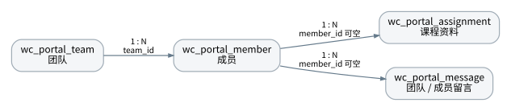
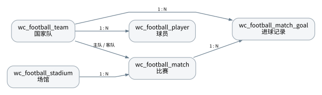
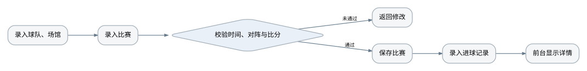

# 2026 世界杯主题团队门户网站

# 设计文档

**课程：** 互联网数据库开发　　**文档版本：** 1.2　　**日期：** 2026 年 11 月 27 日  
**小组名称：** 404 队  
**小组成员：** 陈涵（2411567）、林泽森（2413576）、谭锦睿（2412771）  
**代码仓库：** https://github.com/1wuyi2/worldcup2026

## 一、总体设计

### 1.1 系统架构

网站采用 Yii2 Advanced 框架。`frontend/` 负责公开展示及前台认证，`backend/` 负责后台管理；两个应用通过 `common/models/` 中的 ActiveRecord 模型访问同一数据库。数据库使用 MariaDB/MySQL，业务表按照团队门户、新闻资讯、世界杯赛事分组。

| 技术组成 | 方案 |
| --- | --- |
| Web 框架 | Yii2 Advanced 2.0.55 / PHP 8.0.x |
| 前台界面 | Yii2 View、HTML、CSS、JavaScript |
| 管理后台 | Yii2 Controller、ActiveForm、GridView、AccessControl 与 RBAC |
| 数据存储 | MariaDB/MySQL，InnoDB、utf8mb4 |
| 数据模型 | Yii2 ActiveRecord；Migration 管理建表 |
| 版本与任务管理 | GitHub、Issues、Projects、Pull Request |
| 扩展功能 | Leaflet 场馆地图；动态图表及离线数据导入按扩展需求处理 |

### 1.2 系统模块图

**图 1：系统功能与数据结构**


三个模块使用同一数据库，各自维护独立业务表。全站导航、首页、认证及公共配置作为共享部分统一管理。

## 二、功能模块设计

| 模块 | 前台功能 | 后台功能 | 数据表数量 |
| --- | --- | --- | ---: |
| A：团队门户 | 团队与成员个人主页、留言板、作业筛选下载 | 团队及成员编辑、团队/成员留言发布、作业上传与维护 | 4 |
| B：新闻资讯 | 新闻列表、详情、分类、搜索、标签 | 分类、文章、标签维护和发布状态 | 4 |
| C：世界杯赛事 | 国家队与球员筛选、场馆地图、赛事中心、淘汰赛、比赛详情 | 球队、球员、场馆、比赛、进球维护 | 5 |
| 公共模块 | 首页、统一导航与页脚、注册登录 | 独立登录、权限导航及管理工作台 | 使用框架基础表 |

现行业务功能对应 13 张业务表；数据库另有 1 张历史兼容表及 6 张框架基础表，共 20 张物理表。历史兼容结构不列为现行业务功能。各业务模块使用相应的 Model、Controller、View 和数据库 Migration。模块负责人由实际 GitHub 任务分配确定，设计文档不预先绑定具体姓名。

## 三、数据库设计

### 3.1 数据库与命名规范

数据库名称由本地配置决定，原设计示例为 `worldcup2026_db`，当前集成测试使用 `worldcup2026_abc_test`，与其他本地项目数据库分离。业务表统一以 `wc_` 开头，分别使用 `wc_portal_*`、`wc_news_*`、`wc_football_*`。

除文章标签关联表外，业务表使用 `id BIGINT UNSIGNED AUTO_INCREMENT` 为主键，并包含 `created_at`、`updated_at` 时间字段。业务实体外键使用与目标主键一致的类型；记录后台操作人员的 `created_by_user_id` 使用与框架用户 ID 对应的 INT 类型，仅建立索引，不设置数据库外键。有关联的数据优先建立外键及索引。模块之间不设置跨模块外键，避免增加开发依赖。

### 3.2 数据字典：A 团队门户（4 张现行业务表）

**表 A1：`wc_portal_team` — 团队资料**

| 字段 | 类型 | 约束 | 说明 |
| --- | --- | --- | --- |
| id | BIGINT UNSIGNED | PK，自增 | 团队编号 |
| name | VARCHAR(100) | NOT NULL | 队名 |
| description | TEXT | 可空 | 团队介绍 |
| logo_path | VARCHAR(255) | 可空 | 展示图片相对路径 |
| created_at / updated_at | INT UNSIGNED | NOT NULL | 创建与修改时间 |

**表 A2：`wc_portal_member` — 团队成员**

| 字段 | 类型 | 约束 | 说明 |
| --- | --- | --- | --- |
| id | BIGINT UNSIGNED | PK，自增 | 成员编号 |
| team_id | BIGINT UNSIGNED | FK，非空 | 所属团队 |
| name | VARCHAR(60) | NOT NULL | 姓名 |
| student_no | VARCHAR(20) | 可空 | 学号 |
| role | VARCHAR(60) | 可空 | 成员职责 |
| bio | TEXT | 可空 | 个人介绍 |
| avatar_path | VARCHAR(255) | 可空 | 展示头像路径 |
| sort_order | INT | 可空，默认 0 | 展示顺序 |
| created_at / updated_at | INT UNSIGNED | NOT NULL | 创建与修改时间 |

`team_id` 关联 `wc_portal_team.id`。

**表 A3：`wc_portal_message` — 留言**

| 字段 | 类型 | 约束 | 说明 |
| --- | --- | --- | --- |
| id | BIGINT UNSIGNED | PK，自增 | 留言编号 |
| display_name | VARCHAR(60) | NOT NULL | 发布者显示名称 |
| content | TEXT | NOT NULL | 留言内容 |
| member_id | BIGINT UNSIGNED | FK，可空 | 个人留言所属成员；团队留言为空 |
| source_type | TINYINT UNSIGNED | 非空，默认 0 | 0 历史访客、1 后台发布 |
| created_by_user_id | INT | 可空，索引 | 后台操作账号 ID，无数据库外键 |
| status | TINYINT UNSIGNED | 可空，默认 0 | 0 待审核（未公开）、1 已发布、2 隐藏 |
| created_at / updated_at | INT UNSIGNED | NOT NULL | 创建与修改时间 |

前台仅显示 `source_type=1` 且 `status=1` 的留言，按成员关联区分团队寄语与个人心得；后台可按状态、身份及成员筛选。`member_id` 关联 `wc_portal_member.id`，删除及更新采用 RESTRICT。

**表 A4：`wc_portal_assignment` — 课程资料**

| 字段 | 类型 | 约束 | 说明 |
| --- | --- | --- | --- |
| id | BIGINT UNSIGNED | PK，自增 | 文件记录编号 |
| title | VARCHAR(150) | NOT NULL | 文件标题 |
| category | VARCHAR(20) | NOT NULL | `team` / `personal` |
| member_id | BIGINT UNSIGNED | FK，可空 | 个人作业所属成员；团队作业为空 |
| owner_label | VARCHAR(60) | 可空 | 所属团队或个人 |
| relative_path | VARCHAR(255) | NOT NULL | 下载文件的相对路径 |
| description | TEXT | 可空 | 文件说明 |
| status | TINYINT UNSIGNED | 可空，默认 0 | 0 未发布、1 已发布 |
| created_at / updated_at | INT UNSIGNED | NOT NULL | 创建与修改时间 |

`member_id` 关联 `wc_portal_member.id`，删除及更新采用 RESTRICT。个人作业按成员归档，团队作业不绑定个人。上述留言及作业新增字段由 `m261126_150000_add_portal_publisher_relations` 迁移建立。

个人资料与登录账号相互独立，`wc_portal_member` 不绑定 `user`。文件须位于允许公开的 `data/team/` 或 `data/personal/` 范围。下载控制器按照数据库中的已发布记录读取文件，校验真实路径并拒绝越界访问。

### 3.3 数据字典：B 新闻资讯（4 张）

**表 B1：`wc_news_category` — 新闻分类**

| 字段 | 类型 | 约束 | 说明 |
| --- | --- | --- | --- |
| id | BIGINT UNSIGNED | PK，自增 | 分类编号 |
| name | VARCHAR(60) | UNIQUE，非空 | 分类名称 |
| sort_order | INT | 非空，默认 0 | 排序 |
| status | TINYINT UNSIGNED | 非空，默认 1 | 0 停用、1 启用 |
| created_at / updated_at | INT UNSIGNED | NOT NULL | 创建与修改时间 |

**表 B2：`wc_news_article` — 新闻文章**

| 字段 | 类型 | 约束 | 说明 |
| --- | --- | --- | --- |
| id | BIGINT UNSIGNED | PK，自增 | 文章编号 |
| category_id | BIGINT UNSIGNED | FK，非空 | 新闻分类 |
| title | VARCHAR(200) | NOT NULL | 文章标题 |
| summary | TEXT | 可空 | 摘要 |
| body | MEDIUMTEXT | NOT NULL | 新闻正文 |
| source_name | VARCHAR(100) | 可空 | 信息来源 |
| source_url | VARCHAR(500) | 可空 | 来源网页 |
| published_at | INT UNSIGNED | 可空 | 发布时间 |
| status | TINYINT UNSIGNED | 非空，默认 0 | 0 草稿、1 发布、2 撤稿 |
| created_at / updated_at | INT UNSIGNED | NOT NULL | 创建与修改时间 |

`category_id` 关联 `wc_news_category.id`。前台仅展示已发布、所属分类启用且发布时间不晚于当前时间的文章，按发布时间降序排列。新闻正文由成员整理编写。本阶段不增加封面字段及上传功能。分类外键采用 RESTRICT；文章或标签删除时级联删除相应关联记录。

**表 B3：`wc_news_tag` — 新闻标签**

| 字段 | 类型 | 约束 | 说明 |
| --- | --- | --- | --- |
| id | BIGINT UNSIGNED | PK，自增 | 标签编号 |
| name | VARCHAR(60) | NOT NULL | 标签名称 |
| slug | VARCHAR(80) | UNIQUE，非空 | 标签标识 |
| created_at / updated_at | INT UNSIGNED | NOT NULL | 创建与修改时间 |

**表 B4：`wc_news_article_tag` — 文章标签关联**

| 字段 | 类型 | 约束 | 说明 |
| --- | --- | --- | --- |
| article_id | BIGINT UNSIGNED | 联合主键、FK | 新闻文章 |
| tag_id | BIGINT UNSIGNED | 联合主键、FK | 新闻标签 |

`article_id` 关联 `wc_news_article.id`，`tag_id` 关联 `wc_news_tag.id`；使用 `(article_id, tag_id)` 联合主键，避免重复关联。不设置独立自增 ID。

### 3.4 数据字典：C 世界杯赛事（5 张）

**表 C1：`wc_football_team` — 国家队**

| 字段 | 类型 | 约束 | 说明 |
| --- | --- | --- | --- |
| id | BIGINT UNSIGNED | PK，自增 | 球队编号 |
| name | VARCHAR(100) | NOT NULL | 球队名称 |
| country_code | VARCHAR(10) | UNIQUE，非空 | 球队代码 |
| group_name | VARCHAR(10) | 可空 | 小组 |
| source_url | VARCHAR(500) | 可空 | 资料来源 |
| created_at / updated_at | INT UNSIGNED | NOT NULL | 创建与修改时间 |

**表 C2：`wc_football_player` — 球员**

| 字段 | 类型 | 约束 | 说明 |
| --- | --- | --- | --- |
| id | BIGINT UNSIGNED | PK，自增 | 球员编号 |
| team_id | BIGINT UNSIGNED | FK，非空 | 所属球队 |
| name | VARCHAR(100) | NOT NULL | 球员姓名 |
| number | INT UNSIGNED | 可空 | 球衣号码 |
| position | VARCHAR(30) | 可空 | 位置 |
| source_url | VARCHAR(500) | 可空 | 资料来源 |
| created_at / updated_at | INT UNSIGNED | NOT NULL | 创建与修改时间 |

`team_id` 关联 `wc_football_team.id`。球员姓名不作为唯一键，避免同名球员冲突。

**表 C3：`wc_football_stadium` — 比赛场馆**

| 字段 | 类型 | 约束 | 说明 |
| --- | --- | --- | --- |
| id | BIGINT UNSIGNED | PK，自增 | 场馆编号 |
| name | VARCHAR(100) | NOT NULL | 场馆名称 |
| city | VARCHAR(100) | NOT NULL | 城市 |
| capacity | INT UNSIGNED | 可空 | 容量 |
| source_url | VARCHAR(500) | 可空 | 资料来源 |
| created_at / updated_at | INT UNSIGNED | NOT NULL | 创建与修改时间 |

**表 C4：`wc_football_match` — 比赛记录**

| 字段 | 类型 | 约束 | 说明 |
| --- | --- | --- | --- |
| id | BIGINT UNSIGNED | PK，自增 | 比赛编号 |
| home_team_id | BIGINT UNSIGNED | FK，非空 | 对阵一方 |
| away_team_id | BIGINT UNSIGNED | FK，非空 | 对阵另一方 |
| stadium_id | BIGINT UNSIGNED | FK，可空 | 比赛场馆 |
| match_time | DATETIME | NOT NULL | 开球时间（统一 UTC） |
| stage | VARCHAR(30) | NOT NULL | 比赛阶段 |
| home_score | INT UNSIGNED | 可空 | 第一队比分 |
| away_score | INT UNSIGNED | 可空 | 第二队比分 |
| status | TINYINT UNSIGNED | 非空，默认 0 | 0 未开始、1 进行中、2 完赛、3 延期/取消 |
| result_note | VARCHAR(255) | 可空 | 赛果补充说明，如点球大战 |
| source_match_key | VARCHAR(80) | UNIQUE，可空 | 外部数据唯一识别码 |
| source_url | VARCHAR(500) | 可空 | 比赛来源 |
| created_at / updated_at | INT UNSIGNED | NOT NULL | 创建与修改时间 |

`home_team_id`、`away_team_id` 均关联 `wc_football_team.id`，`stadium_id` 关联 `wc_football_stadium.id`。数据库 CHECK 约束及后台校验限制两队不同，比分使用无符号整数；未核实的比分保持为空。球队虽采用 `home/away` 字段名，前台可统一显示为“对阵双方”。

**表 C5：`wc_football_match_goal` — 进球记录**

| 字段 | 类型 | 约束 | 说明 |
| --- | --- | --- | --- |
| id | BIGINT UNSIGNED | PK，自增 | 进球编号 |
| match_id | BIGINT UNSIGNED | FK，非空 | 所属比赛 |
| team_id | BIGINT UNSIGNED | FK，非空 | 记分归属队伍 |
| scorer_name | VARCHAR(100) | NOT NULL | 进球者姓名 |
| minute_text | VARCHAR(12) | 可空 | 进球分钟，如 `90+3` |
| goal_type | VARCHAR(20) | 非空，默认 `normal` | 普通、乌龙球等类型 |
| source_url | VARCHAR(500) | 可空 | 事件来源 |
| created_at / updated_at | INT UNSIGNED | NOT NULL | 创建与修改时间 |

`match_id` 关联 `wc_football_match.id`，`team_id` 关联 `wc_football_team.id`。每条进球记录需对应实际参赛队伍；暂不强制把进球者姓名与球员表建立外键。点球大战应另作赛果说明，不直接作为普通进球相加。

### 3.5 历史兼容结构与框架基础表

当前数据库仍保留早期访客留言的兼容结构，但现行业务不再接受游客投稿，也不对团队寄语或成员心得提供回复。`PortalGuestbookController::actionReply()` 仅允许 `source_type=0` 的历史访客记录，后台删除历史留言时通过事务处理关联记录；前台 `GuestbookController` 只有 `actionIndex()`，且仅查询 `source_type=1 AND status=1`。因此该表不列入当前公开功能和主业务流程。

**历史兼容表：`wc_portal_reply`**

| 字段 | 类型 | 约束 | 说明 |
| --- | --- | --- | --- |
| id | BIGINT UNSIGNED | PK，自增 | 回复编号 |
| message_id | BIGINT UNSIGNED | FK、UNIQUE，非空 | 对应留言 |
| content | TEXT | NOT NULL | 回复内容 |
| admin_user_id | BIGINT UNSIGNED | 可空 | 历史回复操作人员编号，无数据库外键 |
| created_at / updated_at | INT UNSIGNED | NOT NULL | 创建与修改时间 |

`message_id` 外键关联 `wc_portal_message.id`，并具有唯一索引，单条历史留言最多关联一条历史回复。现有结构不需要为文档调整而删除。

框架基础表如下：

| 数据表 | 用途 |
| --- | --- |
| `user` | 账号、密码哈希、身份认证密钥及状态 |
| `auth_item` | RBAC 角色与权限 |
| `auth_item_child` | 角色和权限层级 |
| `auth_assignment` | 用户授权记录 |
| `auth_rule` | RBAC 规则 |
| `migration` | 已执行迁移记录 |

`user.id` 为 INT 自增主键；`username`、`email` 具有唯一约束。`auth_assignment.user_id` 为 VARCHAR(64)，未设置到 `user` 的数据库外键。用户关联由应用层管理。业务表使用 utf8mb4，用户与 RBAC 表实际使用 utf8。

### 3.6 表间关系（ER 图）

各业务模块独立维护数据表，下图分别表示模块内部的主要关联关系。

**图 2：团队门户模块 ER 图**



**图 3：新闻资讯模块 ER 图**


**图 4：世界杯赛事模块 ER 图**



`wc_portal_assignment.member_id` 与 `wc_portal_message.member_id` 均可关联成员；团队记录允许该字段为空。历史兼容表及其外键单独说明，不画入现行业务 ER 图。球队与比赛的关联分别由 `home_team_id` 和 `away_team_id` 实现。

图中球队到比赛实际有两条外键关系，分别表示对阵双方。后台发布者账号与留言之间是逻辑关联，不作为物理外键绘制。

## 四、页面与 MVC 设计

### 4.1 页面设计

| 模块 | 前台页面 | 后台页面 |
| --- | --- | --- |
| 公共 | 首页、统一导航、注册及登录 | 独立登录、管理工作台 |
| A | 团队介绍、成员详情、留言板、作业列表 | 团队编辑、成员管理、留言发布及历史记录维护、资料上传维护 |
| B | 新闻列表、新闻详情、分类和标签查询 | 新闻分类、文章和标签管理 |
| C | 国家队列表、球员列表、场馆卡片与地图、比赛列表与详情、淘汰赛 | 国家队、球员、场馆、比赛、进球记录管理 |

### 4.2 控制器与路由

| 模块 | 前台控制器 / 示例路由 | 后台控制器 |
| --- | --- | --- |
| A | `TeamController`（`team/index`、`team/member`）；`GuestbookController`（`guestbook/index`）；`AssignmentController`（`assignment/index`、`assignment/download`） | `PortalTeamController`、`PortalMemberController`、`PortalGuestbookController`、`PortalAssignmentController` |
| B | `NewsController`（`news/index`、`news/view`） | `NewsController`、`NewsCategoryController`、`NewsTagController` |
| C | `FootballController`（`football/teams`、`football/players`、`football/stadiums`）；`MatchController`（`match/index`、`match/view`、`match/bracket`） | `FootballTeamController`、`FootballPlayerController`、`StadiumController`、`MatchController`、`MatchGoalController` |

前后台控制器位于不同应用目录，相同短类名不会冲突。统一菜单及首页由公共部分链接各模块路由。

公共路由为 `site/index`、`site/signup`、`site/login`、`site/logout`；后台使用 `site/index`、`site/login`、`site/logout`。前台足球页面没有独立的球队、球员或场馆详情 action，球队和场馆通过关联筛选进入球员列表或赛事中心，比赛详情使用 `match/view&id=...`。后台足球控制器继承 `FootballCrudController`，复用列表、新增、编辑和删除操作。

### 4.3 目录结构

```text
worldcup2026/
├── common/models/             # 现行业务及历史兼容 ActiveRecord
├── frontend/controllers/      # 对外展示、认证与下载控制器
├── frontend/views/            # 前台各功能视图
├── backend/controllers/       # 后台管理控制器
├── backend/views/             # 后台各功能视图
├── console/migrations/        # 建表迁移
├── docs/
│   ├── requirements.md
│   └── design.md
├── data/
│   ├── install.sql
│   ├── team/
│   └── personal/
└── scripts/                    # 可选离线导入程序
```

现行业务模型按业务命名为 `PortalTeam`、`PortalMember`、`PortalMessage`、`PortalAssignment`；`NewsCategory`、`NewsArticle`、`NewsTag`、`NewsArticleTag`；`FootballTeam`、`FootballPlayer`、`FootballStadium`、`FootballMatch`、`FootballMatchGoal`。`PortalReply` 仅作为历史兼容模型保留。

### 4.4 用户认证与权限设计

前后台共享 `common/models/User.php` 及 RBAC 数据，但分别使用独立 Session、身份 Cookie 和 CSRF 配置。前台 `SignupForm` 注册后直接激活账号，使用密码哈希及 auth key，不要求邮件验证；旧邮件验证及密码重置入口停用。

| 组件 | 作用 |
| --- | --- |
| `common/models/LoginForm.php` | 公共登录验证 |
| `backend/models/BackendLoginForm.php` | 后台登录时额外检查管理资格 |
| `common/components/BackendAccess.php` | 统一检查是否具备任一业务管理权限 |
| `backend/components/BackendAccessGuard.php` | 后台请求前检查登录及管理资格，权限撤销后限制继续访问 |

| RBAC 权限 | 管理范围 |
| --- | --- |
| `managePortal` | 团队、成员、课程作业、留言 |
| `manageNews` | 新闻文章、分类、标签 |
| `manageFootball` | 比赛、球队、球员、场馆、进球 |

前台账户菜单只向具备实际管理权限的用户显示后台入口。后台各业务控制器继续执行模块级权限检查，隐藏菜单不替代服务端授权。退出登录使用 POST 并保留 CSRF 防护。前后台跳转地址由公共参数 `frontendBaseUrl`、`backendBaseUrl` 统一配置。

### 4.5 公共界面与管理工作台

前台采用 Midnight Pitch 视觉体系，首页及足球页面突出赛事内容，新闻采用独立编辑式版面，团队门户采用浅色资料展示区域。公共布局统一导航、页脚及账户入口，页面样式和交互脚本由 AssetBundle 或视图注册。

后台登录使用独立 `layouts/auth.php`；管理页面使用 `layouts/main.php`，由 `admin.css`、`admin.js` 提供深色分组侧边栏、浅色工作区及响应式导航。GridView、ActiveForm、DetailView 和分页器通过公共 CSS 统一适配，保留业务操作及表单验证逻辑。

后台首页由 `SiteController::actionIndex()` 按 RBAC 权限查询各业务表记录数，再交给 `site/index.php` 渲染统计及快捷入口。统计口径为全部管理记录（含草稿及未发布记录），不查询未授权模块。动态图表仍属于后续扩展任务。

### 4.6 业务查询与页面联动

| 页面 | 实际查询及展示方式 |
| --- | --- |
| 成员主页 | `TeamController::actionMember()` 预加载所属团队、已发布个人作业和个人留言 |
| 课程资料 | `AssignmentController` 按分类及成员查询已发布记录，下载时检查文件路径 |
| 留言板 | `PortalMessage::findPublishedAdmin()` 限制发布来源及状态，按创建时间和编号降序，每页 10 条 |
| 新闻资讯 | `NewsSearch` 按标题关键词、分类及标签筛选，公开列表每页 10 条；后台另支持状态筛选 |
| 国家队 | 按名称或球队代码搜索，按小组筛选并分组展示 |
| 球员 | 按姓名、球队、位置筛选，预加载球队，每页 26 条 |
| 赛事中心 | 按大阶段、具体阶段、球队、状态及场馆筛选，按比赛时间及编号排序，每页 20 条 |
| 场馆 | 数据库基础信息与 `frontend/config/stadiums.php` 的扩展信息组合，按主办国家筛选，使用分组 COUNT 查询承办比赛数量 |
| 比赛详情 | 预加载两支球队、场馆及进球记录关联球队 |
| 淘汰赛 | 根据 `source_match_key` 和实际胜者逆向构建晋级树，独立展示季军赛 |

场馆国家归属、英文名称、图片、经纬度及重点场馆标记保存在 `frontend/config/stadiums.php`，以数据库场馆 ID 为键，不是 `wc_football_stadium` 字段。Leaflet 使用该扩展配置绘制地图；集成及部署时应保证场馆 ID 与配置对应。在线地图底图的加载取决于网络可用性。

淘汰赛从 `FWC26-M073` 至 `FWC26-M104` 查询比赛，依据决赛逆向匹配各轮获胜队伍。常规及加时比分决定胜者；比分相同时解析 `result_note` 中点球大战结果。只对完赛且比分齐全的记录判断胜者，校验各轮数量 16、8、4、2、1 及 31 场主晋级树比赛的完整性，季军赛另行处理。该方式不新增晋级关系表。

## 五、主要业务流程

### 5.1 团队及成员留言发布

管理员选择团队或成员身份，录入内容并保存发布状态；前台仅展示已发布的后台留言。保存时由服务端根据团队或成员生成 `display_name`，设置 `source_type=1`；新建时记录当前后台用户 ID。状态 0 或 2 均不公开，只有状态 1 进入前台查询。前台留言板只读，支持身份及成员筛选，每页 10 条。现行留言不提供回复操作；历史记录不进入公开列表。

**图 5：留言发布流程**


### 5.2 新闻发布

新闻文章通过 `NewsArticleForm` 保存文章及标签关联，公开查询统一使用 `NewsArticle::publishedQuery()`；草稿、撤稿、停用分类及未来发布时间的文章不进入公开列表。

**图 6：新闻发布流程**


### 5.3 赛事信息维护

**图 7：赛事信息维护流程**



## 六、数据维护及导入

### 6.1 数据维护方式

模块 A 的资料由小组成员录入；模块 B 的新闻由成员根据公开资料整理后在后台发布；模块 C 的球队、阵容、场馆和比赛数据以 FIFA 等官方资料核对后录入。可使用 OpenFootball 的 JSON 数据作离线整理和批量导入，首版不要求爬虫。新闻负责人可独立录入后仅导出四张新闻业务表的数据，集成前核查主键、分类及标签关联；不覆盖其他模块数据库。

比赛导入顺序为：国家队 → 球员与场馆 → 比赛 → 进球记录。导入程序先匹配球队和场馆，再写入相关外键；无法确定的记录暂不导入。导入前检查格式及重复数据，不覆盖后台人工修正的记录。

### 6.2 时间与事件处理

比赛开球时间统一按 UTC 存储，页面显示时由应用转换为约定时区。补时分钟以字符串保存；未核实的比分或进球事件不自行推测。赛果与进球事件分别保存，以处理加时、乌龙球和点球大战等特殊情况。

### 6.3 文件资料管理

团队与个人作业分别保存于 `data/team/`、`data/personal/`，数据库只记录文件信息和受控相对路径。公开下载使用专用控制器，校验发布状态及目标路径，避免用户通过拼接路径访问其他文件。

## 七、团队开发与集成

三个业务模块分别修改各自的模型、控制器、视图和迁移文件。公共部分统一维护首页、布局、管理员授权、`composer.json` 和最终 SQL 文件，避免多人直接编辑相同文件。

| 范围 | 文件或目录 |
| --- | --- |
| A 模块 | `Portal*` 模型、`team/`、`guestbook/`、`assignment/` 相关 MVC |
| B 模块 | `News*` 模型、`news/` 相关 MVC |
| C 模块 | `Football*` 模型、`Match*` 模型、`football/`、`match/` 相关 MVC |
| 公共部分 | `layouts/main.php`、`site/index`、基础授权、公共配置 |
| 数据库变更 | 各模块新增独立 Migration，集成阶段统一导出 `data/install.sql` |

协作使用 GitHub Issues 记录任务，Projects 跟踪状态，成员在 `feature/*` 分支开发，完成后提交 Pull Request 合并到 `dev`，集成测试通过后合并到 `main`。各成员的实际代码贡献以提交记录及对应 MVC 文件为依据。

## 八、部署与测试设计

### 8.1 部署流程

1. 安装 PHP 8.0.x、Composer、MariaDB/MySQL，并拉取 GitHub 项目。
2. 执行 `composer install` 安装依赖，生成各自的 Yii2 本地配置。
3. 新建独立的 `worldcup2026_db` 数据库，配置项目数据库连接。
4. 采用 **导入与交付版本匹配的 `data/install.sql`** 或 **运行 Migration** 完成结构初始化，不重复建表。已有数据库先备份并执行未应用的迁移。
5. 创建管理员账号并设置权限，检查前后台访问与各模块主要页面。

本地 `*-local.php`、管理员密码与其他密钥不进入 Git。最终的 `data/install.sql` 应包含必要的结构、迁移历史及可公开的业务数据，不包含真实账号密码；当前尚需在最终数据合并后更新并验证恢复部署。

### 8.2 功能测试

| 测试 | 检查内容 |
| --- | --- |
| 团队信息 | 后台修改后前台能看到更新 |
| 留言发布 | 后台录入团队或成员留言，发布后前台展示；历史访客留言不公开 |
| 作业下载 | 只允许下载已发布且实际存在的文件 |
| 新闻发布 | 草稿不公开，发布后列表与详情显示正确 |
| 球队与比赛 | 关联关系有效，比赛信息、比分和进球展示正确 |
| 权限 | 普通用户不能进入后台，单模块管理员不能访问未授权模块，前后台登录状态独立 |
| 管理工作台 | 统计与数据库实际记录一致，仅显示授权模块 |
| 恢复部署 | 空数据库可依据部署文档还原，并通过主要页面测试 |
| 团队贡献 | 三名成员有各自的 Model、View、Controller 与提交记录 |

### 8.3 建议演示数据

团队资料 1 条、成员 3 条及相应作业、寄语和个人心得；新闻按实际整理结果录入分类、文章、标签；足球数据按现有赛事资料核验。历史兼容表不要求演示数据。最终记录数以集成数据库为准，不将测试数据当作真实记录。

---

**文档对应：** 本设计文档配套 `docs/requirements.md`，本次修订依据 2026-11-27 最新核心源码及同日导出的 `worldcup2026-schema.sql`；已核对物理表结构和控制器路由。最终业务记录数量、完整部署及综合测试结果仍需在交付前验证。
