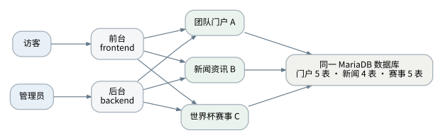
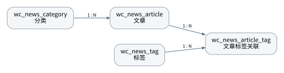
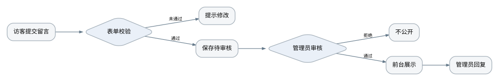

# 2026 世界杯主题团队门户网站

# 设计文档

**课程：** 互联网数据库开发　　**文档版本：** 1.0　　**日期：** 2026 年 11 月 18 日  
**小组名称：** 世界杯主题开发小组  
**小组成员：** 陈涵（2411567）、林泽森（2413576）、谭锦睿（2412771）  
**代码仓库：** https://github.com/1wuyi2/worldcup2026

## 一、总体设计

### 1.1 系统架构

网站采用 Yii2 Advanced 框架。`frontend/` 负责游客页面，`backend/` 负责后台管理；两个应用通过 `common/models/` 中的 ActiveRecord 模型访问同一数据库。数据库使用 MariaDB/MySQL，业务表按照团队门户、新闻资讯、世界杯赛事分组。

| 技术组成 | 方案 |
| --- | --- |
| Web 框架 | Yii2 Advanced 2.0.55 / PHP 8.0.x |
| 前台界面 | Yii2 View、HTML、CSS、JavaScript |
| 管理后台 | Yii2 Controller、表单校验及 AccessControl |
| 数据存储 | MariaDB/MySQL，InnoDB、utf8mb4 |
| 数据模型 | Yii2 ActiveRecord；Migration 管理建表 |
| 版本与任务管理 | GitHub、Issues、Projects、Pull Request |
| 扩展功能 | 可选 ECharts 图表；可选离线数据导入脚本 |

### 1.2 系统模块图

**图 1：系统功能与数据结构**



三个模块使用同一数据库，各自维护独立业务表。全站导航、首页、认证及公共配置作为共享部分统一管理。

## 二、功能模块设计

| 模块 | 前台功能 | 后台功能 | 数据表数量 |
| --- | --- | --- | ---: |
| A：团队门户 | 团队与成员、留言板、作业下载 | 团队及成员编辑、留言审核回复、作业资源维护 | 5 |
| B：新闻资讯 | 新闻列表、详情、分类、搜索、标签 | 分类、文章、标签维护和发布状态 | 4 |
| C：世界杯赛事 | 国家队、球员、场馆、赛程和进球信息 | 球队、球员、场馆、比赛、进球维护 | 5 |
| 公共模块 | 首页、统一导航与页脚 | 管理员登录与访问控制 | 使用框架基础表 |

各业务模块需完成相应的 Model、Controller、View 和数据库 Migration。模块负责人由实际 GitHub 任务分配确定，设计文档不预先绑定具体姓名。

## 三、数据库设计

### 3.1 数据库与命名规范

数据库名称使用 `worldcup2026_db`，与其他本地项目数据库分离。业务表统一以 `wc_` 开头，分别使用 `wc_portal_*`、`wc_news_*`、`wc_football_*`。

除文章标签关联表外，业务表使用 `id BIGINT UNSIGNED AUTO_INCREMENT` 为主键，并包含 `created_at`、`updated_at` 时间字段。外键使用同类型的 `<对象>_id`。有关联的数据优先建立外键及索引。模块之间不设置跨模块外键，避免增加开发依赖。

### 3.2 数据字典：A 团队门户（5 张）

**表 A1：`wc_portal_team` — 团队资料**

| 字段 | 类型 | 约束 | 说明 |
| --- | --- | --- | --- |
| id | BIGINT UNSIGNED | PK，自增 | 团队编号 |
| name | VARCHAR(100) | NOT NULL | 队名 |
| description | TEXT | 可空 | 团队介绍 |
| logo_path | VARCHAR(255) | 可空 | 展示图片相对路径 |
| created_at / updated_at | INT UNSIGNED | NOT NULL | 创建与修改时间 |

**表 A2：`wc_portal_member` — 团队成员**

| 字段 | 类型 | 约束 | 说明 |
| --- | --- | --- | --- |
| id | BIGINT UNSIGNED | PK，自增 | 成员编号 |
| team_id | BIGINT UNSIGNED | FK，非空 | 所属团队 |
| name | VARCHAR(60) | NOT NULL | 姓名 |
| student_no | VARCHAR(20) | 可空 | 学号 |
| role | VARCHAR(60) | 可空 | 成员职责 |
| bio | TEXT | 可空 | 个人介绍 |
| avatar_path | VARCHAR(255) | 可空 | 展示头像路径 |
| sort_order | INT | 默认 0 | 展示顺序 |
| created_at / updated_at | INT UNSIGNED | NOT NULL | 创建与修改时间 |

`team_id` 关联 `wc_portal_team.id`。

**表 A3：`wc_portal_message` — 留言**

| 字段 | 类型 | 约束 | 说明 |
| --- | --- | --- | --- |
| id | BIGINT UNSIGNED | PK，自增 | 留言编号 |
| display_name | VARCHAR(60) | NOT NULL | 留言昵称 |
| content | TEXT | NOT NULL | 留言内容 |
| status | TINYINT UNSIGNED | 默认 0 | 0 待审核、1 已发布、2 隐藏 |
| created_at / updated_at | INT UNSIGNED | NOT NULL | 创建与修改时间 |

前台只显示 `status=1` 的留言；后台可按状态筛选和审核。

**表 A4：`wc_portal_reply` — 留言回复**

| 字段 | 类型 | 约束 | 说明 |
| --- | --- | --- | --- |
| id | BIGINT UNSIGNED | PK，自增 | 回复编号 |
| message_id | BIGINT UNSIGNED | FK，非空 | 对应留言 |
| content | TEXT | NOT NULL | 回复内容 |
| admin_user_id | BIGINT UNSIGNED | 可空 | 回复管理员的框架用户 ID |
| created_at / updated_at | INT UNSIGNED | NOT NULL | 创建与修改时间 |

`message_id` 关联 `wc_portal_message.id`。首版界面按一条留言对应一条公开回复处理；不向游客公开尚未审核通过的留言回复。

**表 A5：`wc_portal_assignment` — 课程资料**

| 字段 | 类型 | 约束 | 说明 |
| --- | --- | --- | --- |
| id | BIGINT UNSIGNED | PK，自增 | 文件记录编号 |
| title | VARCHAR(150) | NOT NULL | 文件标题 |
| category | VARCHAR(20) | NOT NULL | `team` / `personal` |
| owner_label | VARCHAR(60) | 可空 | 所属团队或个人 |
| relative_path | VARCHAR(255) | NOT NULL | 下载文件的相对路径 |
| description | TEXT | 可空 | 文件说明 |
| status | TINYINT UNSIGNED | 默认 0 | 0 未发布、1 已发布 |
| created_at / updated_at | INT UNSIGNED | NOT NULL | 创建与修改时间 |

文件须位于允许公开的 `data/team/` 或 `data/personal/` 范围。下载控制器按照数据库中的已发布记录读取文件，校验真实路径并拒绝越界访问。

### 3.3 数据字典：B 新闻资讯（4 张）

**表 B1：`wc_news_category` — 新闻分类**

| 字段 | 类型 | 约束 | 说明 |
| --- | --- | --- | --- |
| id | BIGINT UNSIGNED | PK，自增 | 分类编号 |
| name | VARCHAR(60) | UNIQUE，非空 | 分类名称 |
| sort_order | INT | 默认 0 | 排序 |
| status | TINYINT UNSIGNED | 默认 1 | 0 停用、1 启用 |
| created_at / updated_at | INT UNSIGNED | NOT NULL | 创建与修改时间 |

**表 B2：`wc_news_article` — 新闻文章**

| 字段 | 类型 | 约束 | 说明 |
| --- | --- | --- | --- |
| id | BIGINT UNSIGNED | PK，自增 | 文章编号 |
| category_id | BIGINT UNSIGNED | FK，非空 | 新闻分类 |
| title | VARCHAR(200) | NOT NULL | 文章标题 |
| summary | TEXT | 可空 | 摘要 |
| body | MEDIUMTEXT | NOT NULL | 新闻正文 |
| source_name | VARCHAR(100) | 可空 | 信息来源 |
| source_url | VARCHAR(500) | 可空 | 来源网页 |
| published_at | INT UNSIGNED | 可空 | 发布时间 |
| status | TINYINT UNSIGNED | 默认 0 | 0 草稿、1 发布、2 撤稿 |
| created_at / updated_at | INT UNSIGNED | NOT NULL | 创建与修改时间 |

`category_id` 关联 `wc_news_category.id`。前台仅展示已发布文章，按发布时间降序排列。新闻正文由成员整理编写。

**表 B3：`wc_news_tag` — 新闻标签**

| 字段 | 类型 | 约束 | 说明 |
| --- | --- | --- | --- |
| id | BIGINT UNSIGNED | PK，自增 | 标签编号 |
| name | VARCHAR(60) | NOT NULL | 标签名称 |
| slug | VARCHAR(80) | UNIQUE，非空 | 标签标识 |
| created_at / updated_at | INT UNSIGNED | NOT NULL | 创建与修改时间 |

**表 B4：`wc_news_article_tag` — 文章标签关联**

| 字段 | 类型 | 约束 | 说明 |
| --- | --- | --- | --- |
| article_id | BIGINT UNSIGNED | 联合主键、FK | 新闻文章 |
| tag_id | BIGINT UNSIGNED | 联合主键、FK | 新闻标签 |

`article_id` 关联 `wc_news_article.id`，`tag_id` 关联 `wc_news_tag.id`；使用 `(article_id, tag_id)` 联合主键，避免重复关联。不设置独立自增 ID。

### 3.4 数据字典：C 世界杯赛事（5 张）

**表 C1：`wc_football_team` — 国家队**

| 字段 | 类型 | 约束 | 说明 |
| --- | --- | --- | --- |
| id | BIGINT UNSIGNED | PK，自增 | 球队编号 |
| name | VARCHAR(100) | NOT NULL | 球队名称 |
| country_code | VARCHAR(10) | UNIQUE，非空 | 球队代码 |
| group_name | VARCHAR(10) | 可空 | 小组 |
| source_url | VARCHAR(500) | 可空 | 资料来源 |
| created_at / updated_at | INT UNSIGNED | NOT NULL | 创建与修改时间 |

**表 C2：`wc_football_player` — 球员**

| 字段 | 类型 | 约束 | 说明 |
| --- | --- | --- | --- |
| id | BIGINT UNSIGNED | PK，自增 | 球员编号 |
| team_id | BIGINT UNSIGNED | FK，非空 | 所属球队 |
| name | VARCHAR(100) | NOT NULL | 球员姓名 |
| number | INT UNSIGNED | 可空 | 球衣号码 |
| position | VARCHAR(30) | 可空 | 位置 |
| source_url | VARCHAR(500) | 可空 | 资料来源 |
| created_at / updated_at | INT UNSIGNED | NOT NULL | 创建与修改时间 |

`team_id` 关联 `wc_football_team.id`。球员姓名不作为唯一键，避免同名球员冲突。

**表 C3：`wc_football_stadium` — 比赛场馆**

| 字段 | 类型 | 约束 | 说明 |
| --- | --- | --- | --- |
| id | BIGINT UNSIGNED | PK，自增 | 场馆编号 |
| name | VARCHAR(100) | NOT NULL | 场馆名称 |
| city | VARCHAR(100) | NOT NULL | 城市 |
| capacity | INT UNSIGNED | 可空 | 容量 |
| source_url | VARCHAR(500) | 可空 | 资料来源 |
| created_at / updated_at | INT UNSIGNED | NOT NULL | 创建与修改时间 |

**表 C4：`wc_football_match` — 比赛记录**

| 字段 | 类型 | 约束 | 说明 |
| --- | --- | --- | --- |
| id | BIGINT UNSIGNED | PK，自增 | 比赛编号 |
| home_team_id | BIGINT UNSIGNED | FK，非空 | 对阵一方 |
| away_team_id | BIGINT UNSIGNED | FK，非空 | 对阵另一方 |
| stadium_id | BIGINT UNSIGNED | FK，可空 | 比赛场馆 |
| match_time | DATETIME | NOT NULL | 开球时间（统一 UTC） |
| stage | VARCHAR(30) | NOT NULL | 比赛阶段 |
| home_score | INT UNSIGNED | 可空 | 第一队比分 |
| away_score | INT UNSIGNED | 可空 | 第二队比分 |
| status | TINYINT UNSIGNED | 默认 0 | 0 未开始、1 进行中、2 完赛、3 延期/取消 |
| source_match_key | VARCHAR(80) | UNIQUE，可空 | 外部数据唯一识别码 |
| source_url | VARCHAR(500) | 可空 | 比赛来源 |
| created_at / updated_at | INT UNSIGNED | NOT NULL | 创建与修改时间 |

`home_team_id`、`away_team_id` 均关联 `wc_football_team.id`，`stadium_id` 关联 `wc_football_stadium.id`。后台校验两队不同、比分非负；未核实的比分保持为空。球队虽采用 `home/away` 字段名，前台可统一显示为“对阵双方”。

**表 C5：`wc_football_match_goal` — 进球记录**

| 字段 | 类型 | 约束 | 说明 |
| --- | --- | --- | --- |
| id | BIGINT UNSIGNED | PK，自增 | 进球编号 |
| match_id | BIGINT UNSIGNED | FK，非空 | 所属比赛 |
| team_id | BIGINT UNSIGNED | FK，非空 | 记分归属队伍 |
| scorer_name | VARCHAR(100) | NOT NULL | 进球者姓名 |
| minute_text | VARCHAR(12) | 可空 | 进球分钟，如 `90+3` |
| goal_type | VARCHAR(20) | 默认 `normal` | 普通、乌龙球等类型 |
| source_url | VARCHAR(500) | 可空 | 事件来源 |
| created_at / updated_at | INT UNSIGNED | NOT NULL | 创建与修改时间 |

`match_id` 关联 `wc_football_match.id`，`team_id` 关联 `wc_football_team.id`。每条进球记录需对应实际参赛队伍；暂不强制把进球者姓名与球员表建立外键。点球大战应另作赛果说明，不直接作为普通进球相加。

### 3.5 表间关系（ER 图）

各业务模块独立维护数据表，下图分别表示模块内部的主要关联关系。

**图 2：团队门户模块 ER 图**


**图 3：新闻资讯模块 ER 图**



**图 4：世界杯赛事模块 ER 图**


`wc_portal_assignment` 为独立文件记录表；球队与比赛的关联在实际数据库中分别由 `home_team_id` 和 `away_team_id` 实现。

图中球队到比赛实际有两条外键关系，分别表示对阵双方；课程资料表作为独立表，不强行关联无关业务数据。

## 四、页面与 MVC 设计

### 4.1 页面规划

| 模块 | 前台页面 | 后台页面 |
| --- | --- | --- |
| 公共 | 首页、统一导航 | 登录、管理首页 |
| A | 团队介绍、成员详情、留言板、作业列表 | 团队编辑、成员管理、留言审核/回复、资料维护 |
| B | 新闻列表、新闻详情、分类和标签查询 | 新闻分类、文章和标签管理 |
| C | 国家队列表、球员列表、比赛列表与详情 | 国家队、球员、场馆、比赛、进球记录管理 |

### 4.2 控制器与路由

| 模块 | 前台控制器 / 示例路由 | 后台控制器 |
| --- | --- | --- |
| A | `TeamController`（`team/index`、`team/view`）；`GuestbookController`（`guestbook/index`、`guestbook/create`）；`AssignmentController`（`assignment/index`、`assignment/download`） | `TeamController`、`MemberController`、`GuestbookController`、`AssignmentController` |
| B | `NewsController`（`news/index`、`news/view`） | `NewsController`、`NewsCategoryController`、`NewsTagController` |
| C | `FootballController`（`football/teams`、`football/players`）；`MatchController`（`match/index`、`match/view`） | `FootballTeamController`、`FootballPlayerController`、`StadiumController`、`MatchController`、`MatchGoalController` |

前后台控制器位于不同应用目录，相同短类名不会冲突。统一菜单及首页由公共部分链接各模块路由。

### 4.3 目录结构

```text
worldcup2026/
├── common/models/             # 14 张业务表对应的 ActiveRecord
├── frontend/controllers/      # 对外展示与留言、下载控制器
├── frontend/views/            # 前台各功能视图
├── backend/controllers/       # 后台管理控制器
├── backend/views/             # 后台各功能视图
├── console/migrations/        # 建表迁移
├── docs/
│   ├── requirements.md
│   └── design.md
├── data/
│   ├── install.sql
│   ├── team/
│   └── personal/
└── scripts/                    # 可选离线导入程序
```

模型按业务命名为 `PortalTeam`、`PortalMember`、`PortalMessage`、`PortalReply`、`PortalAssignment`；`NewsCategory`、`NewsArticle`、`NewsTag`、`NewsArticleTag`；`FootballTeam`、`FootballPlayer`、`FootballStadium`、`FootballMatch`、`FootballMatchGoal`。

## 五、主要业务流程

### 5.1 留言与审核

**图 5：留言审核流程**



### 5.2 新闻发布

**图 6：新闻发布流程**


### 5.3 赛事信息维护

**图 7：赛事信息维护流程**


## 六、数据维护及导入

### 6.1 数据维护方式

模块 A 的资料由小组成员录入；模块 B 的新闻由成员根据公开资料整理后在后台发布；模块 C 的球队、阵容、场馆和比赛数据以 FIFA 等官方资料核对后录入。可使用 OpenFootball 的 JSON 数据作离线整理和批量导入，首版不要求爬虫。

比赛导入顺序为：国家队 → 球员与场馆 → 比赛 → 进球记录。导入程序先匹配球队和场馆，再写入相关外键；无法确定的记录暂不导入。导入前检查格式及重复数据，不覆盖后台人工修正的记录。

### 6.2 时间与事件处理

比赛开球时间统一按 UTC 存储，页面显示时由应用转换为约定时区。补时分钟以字符串保存；未核实的比分或进球事件不自行推测。赛果与进球事件分别保存，以处理加时、乌龙球和点球大战等特殊情况。

### 6.3 文件资料管理

团队与个人作业分别保存于 `data/team/`、`data/personal/`，数据库只记录文件信息和受控相对路径。公开下载使用专用控制器，校验发布状态及目标路径，避免用户通过拼接路径访问其他文件。

## 七、团队开发与集成

三个业务模块分别修改各自的模型、控制器、视图和迁移文件。公共部分统一维护首页、布局、管理员授权、`composer.json` 和最终 SQL 文件，避免多人直接编辑相同文件。

| 范围 | 文件或目录 |
| --- | --- |
| A 模块 | `Portal*` 模型、`team/`、`guestbook/`、`assignment/` 相关 MVC |
| B 模块 | `News*` 模型、`news/` 相关 MVC |
| C 模块 | `Football*` 模型、`Match*` 模型、`football/`、`match/` 相关 MVC |
| 公共部分 | `layouts/main.php`、`site/index`、基础授权、公共配置 |
| 数据库变更 | 各模块新增独立 Migration，集成阶段统一导出 `data/install.sql` |

协作使用 GitHub Issues 记录任务，Projects 跟踪状态，成员在 `feature/*` 分支开发，完成后提交 Pull Request 合并到 `dev`，集成测试通过后合并到 `main`。各成员的实际代码贡献以提交记录及对应 MVC 文件为依据。

## 八、部署与测试设计

### 8.1 部署流程

1. 安装 PHP 8.0.x、Composer、MariaDB/MySQL，并拉取 GitHub 项目。
2. 执行 `composer install` 安装依赖，生成各自的 Yii2 本地配置。
3. 新建独立的 `worldcup2026_db` 数据库，配置项目数据库连接。
4. 采用 **导入 `data/install.sql`** 或 **运行 Migration** 的一种方式完成结构初始化，不重复执行两种建表流程。
5. 创建管理员账号并设置权限，检查前后台访问与各模块主要页面。

本地 `*-local.php`、管理员密码与其他密钥不进入 Git。最终的 `data/install.sql` 包含必要的结构与可公开的演示数据，不包含真实账号密码。

### 8.2 功能测试

| 测试 | 检查内容 |
| --- | --- |
| 团队信息 | 后台修改后前台能看到更新 |
| 留言审核 | 提交、待审核、审核发布、管理员回复流程完整 |
| 作业下载 | 只允许下载已发布且实际存在的文件 |
| 新闻发布 | 草稿不公开，发布后列表与详情显示正确 |
| 球队与比赛 | 关联关系有效，比赛信息、比分和进球展示正确 |
| 权限 | 未授权访问不能新增或修改后台数据 |
| 恢复部署 | 空数据库可依据部署文档还原，并通过主要页面测试 |
| 团队贡献 | 三名成员有各自的 Model、View、Controller 与提交记录 |

### 8.3 建议演示数据

团队资料 1 条、成员 3 条、留言及回复若干；新闻 5–8 篇、分类 2–3 种；赛事部分录入 8–12 支球队、20–30 名球员、4–6 座场馆和 8–12 场比赛，选择其中可核实进球信息的比赛录入进球记录。新闻标签和文章标签关联均应有实际数据与页面用途。

---

**文档对应：** 本设计文档配套 `docs/requirements.md`，作为后续数据库建表、MVC 编码和测试的依据。
